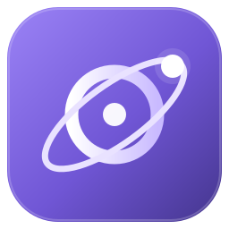
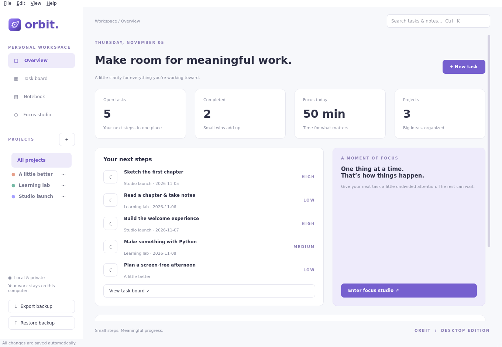
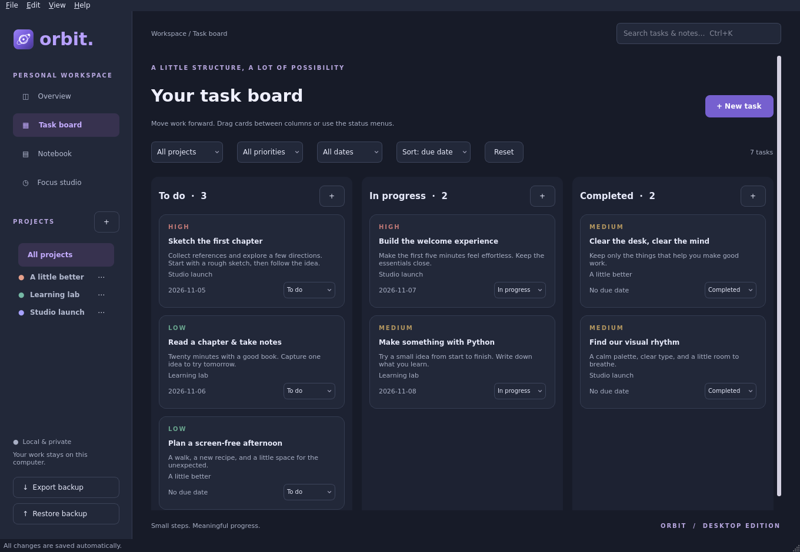
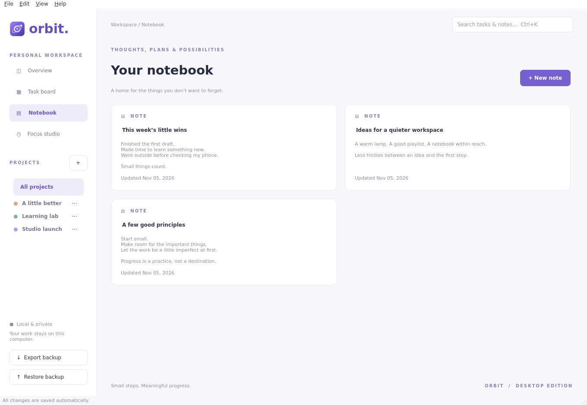
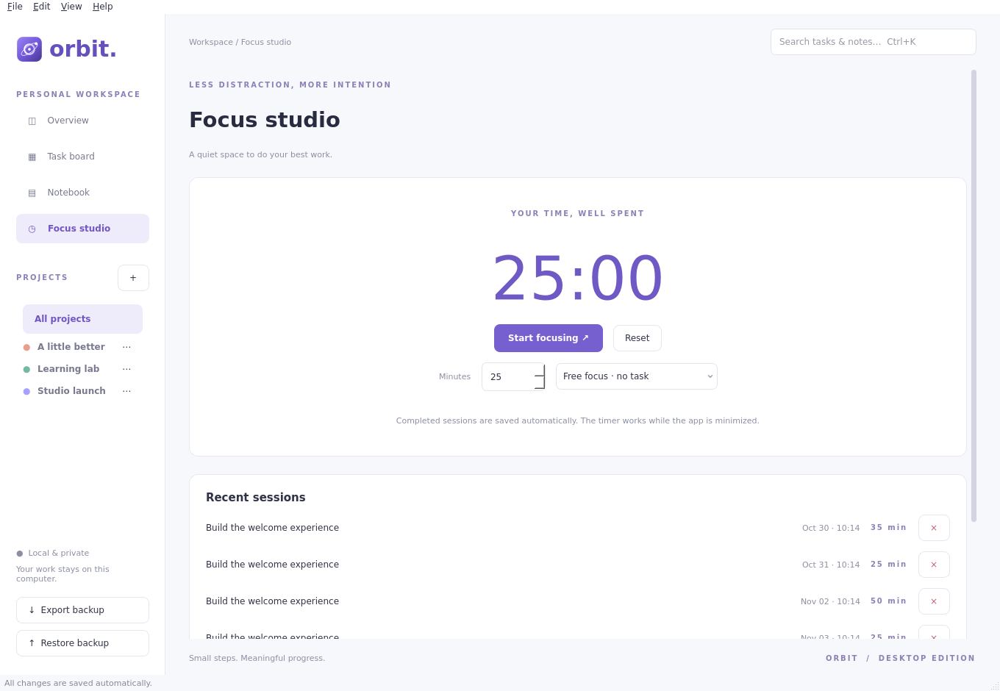

<div align="center">
  
  <h1>Orbit</h1>
  <p><strong>A little clarity for meaningful work.</strong></p>
  <p>A private, native desktop workspace for projects, notes, and focused work.<br>Built with Python, PyQt6, and SQLite.</p>

  
  
  
  
</div>



Orbit brings your next steps, ideas, and focus sessions into one calm desktop window. All work is stored locally. No account, telemetry, browser engine, or network connection is needed to use the app.

## What you can do

| Workspace | Features |
| --- | --- |
| **Overview** | Open tasks, completed work, daily focus totals, prioritized next steps, project progress |
| **Task board** | Drag-and-drop columns, priorities, deadlines, calendar picker, project/date filters, search, sorting, undo moves |
| **Notebook** | Plain text notes, instant search, native editing, unsaved-change confirmation |
| **Focus studio** | Task-linked timer, pause/resume/reset, persistent state, completion sound, session history |

Light and dark appearance, keyboard shortcuts, remembered window geometry, native file dialogs, and a custom desktop icon are included.

<details>
<summary><strong>See the task board in dark appearance</strong></summary>



</details>

<details>
<summary><strong>See the notebook and focus studio</strong></summary>





</details>

Screenshots use synthetic data. Try the same workspace with `python3 app.py --demo`; it runs separately from your own data and is removed when closed.

## Get started

**Requirements:** Python 3.10+ and PyQt6. Linux is the primary target. Windows and macOS packaging and desktop integration have not been validated.

```sh
git clone https://github.com/davidpluharik-wq/Orbit.git
cd Orbit
python3 -m venv .venv
source .venv/bin/activate
python -m pip install -r requirements.txt
python app.py
```

If PyQt6 is already installed, `python3 app.py` is enough.

You can also install the Python package from a checkout:

```sh
python -m pip install .
orbit
```

`python -m orbit` is another entry point. `orbit --version` prints the version without opening a window.

### Desktop shortcut · Linux

Generate a launcher using your current interpreter and checkout location:

```sh
python scripts/install_desktop.py --desktop
```

This writes `Orbit.desktop` in the checkout and copies it to `~/Desktop`. If your desktop asks, right-click the shortcut and select **Allow Launching** or **Trust and Launch**. Run the script again after moving the folder or changing the Python environment. Omit `--desktop` to generate only the local launcher.

### First steps

1. Create a project with the **+** in the sidebar.
2. Add a task. Set its priority, project, status, and optional due date.
3. Move cards between columns, or use the status menus. Click a title to edit.
4. Capture an idea in Notebook, or start a session in Focus studio.
5. Export a backup whenever you want a portable copy of your work.

Use **⋯** beside a project to edit or delete it. Deleting a project preserves its tasks under Personal. On smaller windows the task columns stack vertically.

## Keyboard shortcuts

| Shortcut | Action |
| --- | --- |
| `Ctrl+N` | New task, or new note while in Notebook |
| `Ctrl+Shift+N` | New note from any view |
| `Ctrl+K` | Focus search |
| `Ctrl+1` … `Ctrl+4` | Switch workspaces |
| `Ctrl+Z` | Undo the latest task move |
| `Ctrl+Shift+F` | Clear project, priority, date, and search filters |
| `Ctrl+Shift+D` | Toggle dark appearance |
| `Ctrl+Shift+E` | Export a backup |
| `Ctrl+Enter` | Save the open editor |
| `Escape` | Close the editor; prompts before discarding changes |
| `F1` | Show shortcuts |
| `Ctrl+Q` | Quit |

## Your data

In a source checkout, Orbit keeps `orbit.sqlite3` beside `app.py`. Existing data from earlier versions is read automatically. The original `focus-state.json` timer is migrated once into the database; it is retained as a fallback copy. The database also holds appearance, window geometry, and focus state.

Installed packages use `~/.local/share/orbit` by default. Set `ORBIT_DATA_DIR` to choose a different workspace before starting:

```sh
ORBIT_DATA_DIR=/path/to/workspace orbit
```

- **Export** writes projects, tasks, notes, and session history to a JSON file using an atomic replacement.
- **Restore** replaces these records after validation. Any invalid record or broken link rolls back the entire transaction. Appearance and geometry stay local; an active timer is cleared.
- A focus session and its completed timer state are committed in one SQLite transaction, preventing duplicate recordings after a crash/restart.
- The timer continues while minimized. If you close Orbit during a session, elapsed time still counts; an expired session is recorded when you reopen the app.
- Only one desktop instance can use a workspace at a time. Separate demo workspaces can run alongside your own.

Backups contain your personal notes and tasks. Keep them somewhere private. Exported backups, local databases, and configuration files are excluded from Git by default.

## Development

```sh
python -m pip install -e '.[dev]'
python -m unittest discover -s tests -v
ruff check .
python -m build
```

Tests isolate their databases inside temporary project directories, use Qt’s offscreen backend, and never read or overwrite your personal workspace. Coverage includes native editors, filters, themes, undo, timer migration/recovery, exactly-once completion, input validation, atomic exports, and restore rollback. GitHub Actions runs the suite and builds the package on Python 3.10, 3.12, and 3.14.

Regenerate screenshots with `python scripts/screenshots.py`. The script uses a disposable demo database.

```text
orbit/
├── desktop.py       Native Qt views, editors, menus, and shortcuts
├── storage.py       SQLite schema, repository, validation, and backups
├── focus.py         Persistent focus timer and transactional completion
├── theme.py         Light/dark palettes and widget styling
├── demo.py          Synthetic demo workspace
└── resources/       Packaged application icon
scripts/             Launcher and screenshot tools
tests/               Storage, timer, native UI, and legacy API tests
docs/                Architecture, release notes, and screenshots
```

The original browser interface remains available in `web_app.py` and `static/` for compatibility with the first version. The desktop app does not load either of them. Avoid running the browser and desktop versions against the same workspace simultaneously.

See [CONTRIBUTING.md](CONTRIBUTING.md) for development guidelines, [architecture notes](docs/architecture.md) for design decisions, and [CHANGELOG.md](CHANGELOG.md) for release notes.

## License

[GNU General Public License v3.0](LICENSE). PyQt6 and Qt are third-party projects with their own applicable licensing terms. Orbit does not bundle their binaries in the source repository.
